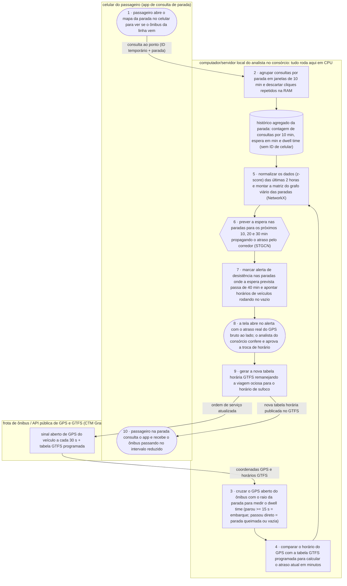

# GrafoParada · Fluxograma e Arquitetura

O caminho de ponta a ponta: do gesto do passageiro consultando o ponto no celular até a conferência do analista do consórcio e o remanejamento de horários que reduz a espera na parada. Artefato **fluxograma e arquitetura** da disciplina AI4Good ([guia](https://lucassf.pages.dev/ai4good/artefatos/3-fluxograma-e-arquitetura)).

Formas: **pessoa** `([ ])` · **IA** `{{ }}` · **regra** `[ ]`. Caixas: onde cada peça roda.

## os dados

| dado pessoal | de quem é | onde fica | quem vê | por quanto tempo | quando é apagado |
|:--|:--|:--|:--|:--|:--|
| localização e IP/ID temporário da consulta ao ponto | passageiro | memória RAM do servidor local (passo 2) | ninguém (apenas a regra de filtro) | no máximo 10 minutos (duração da janela) | apagado da RAM ao fechar a janela de 10 min; no disco (`DB`) só entra o número inteiro total de consultas da parada |
| prefixo do veículo e coordenada GPS em tempo real | operação / motorista em turno | memória de cálculo (passos 3 e 4) no servidor local | analista de planejamento do consórcio (apenas no painel do passo 8) | durante o dia operacional | ao consolidar o histórico diário da parada; fica guardado apenas o atraso e o *dwell time* por parada e horário, sem vínculo com o motorista |
| registro de decisões do analista (alertas aceitos ou recusados) | analista do consórcio | banco local (`DB`) no computador do consórcio | o próprio analista e a auditoria técnica do projeto | até o fim do experimento | ao final da validação do experimento |

Do aparelho do passageiro sai apenas a requisição normal de consulta da parada que o aplicativo de ônibus já envia hoje; nenhum nome, telefone ou histórico individual de rotas é coletado ou salvo em disco.
