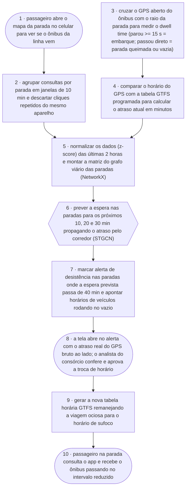

# GrafoParada · Fluxograma e Arquitetura

O caminho de ponta a ponta: do gesto do passageiro consultando o ponto no celular até a conferência do analista do consórcio e o remanejamento de horários que reduz a espera na parada. Artefato **fluxograma e arquitetura** da disciplina AI4Good ([guia](https://lucassf.pages.dev/ai4good/artefatos/3-fluxograma-e-arquitetura)).

Formas: **pessoa** `([ ])` · **IA** `{{ }}` · **regra** `[ ]`.

