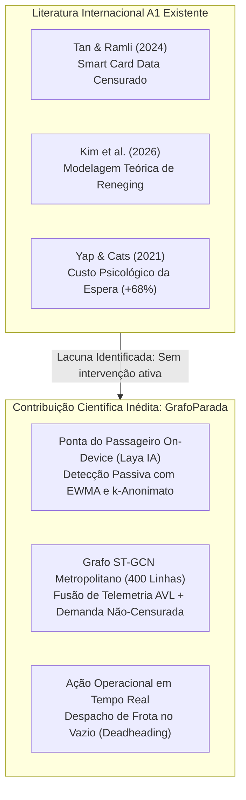

# 📚 Fundamentação Teórica Qualis A1 & Estado da Arte · GrafoParada
> **Disciplina:** Tópicos Avançados em Inteligência Artificial (AI4Good) · UFRPE  
> **Autor:** Cauã da Cunha Lira (`caua.lira@ufrpe.br`)  
> **Orientador / Professor:** Prof. Lucas Silva Figueiredo  
> **Tema:** Modelagem de Abandono de Passageiros (*Passenger Reneging*), Demanda Latente Censurada e Despacho de Frota no Vazio (*Deadheading Mitigation*)

---

## 1. Contexto & O Ponto Cego da Literatura Atual

No transporte público metropolitano, as concessionárias e órgãos gestores (como o Grande Recife Consórcio de Transporte - CTM) mensuram sua demanda quase que exclusivamente pelos **validadores de bilhetagem eletrônica (VEM / Smart Card Data)**.

Contudo, essa métrica sofre de **censura à direita**: ela registra apenas a *demanda atendida*. O passageiro que chega à parada, espera 30 ou 40 minutos sob chuva ou escuridão e desiste (recorrendo ao transporte clandestino, moto-táxi, app de carona ou voltando para casa) **nunca passa pela catraca e se torna estatisticamente invisível**.

A literatura internacional recente categoriza rigorosamente esse ecossistema comportamental em cinco fenômenos bem delimitados:

| Fenômeno | Definição Formal na Literatura | Artigo de Referência Chave | Como o GrafoParada Trata |
| :--- | :--- | :--- | :--- |
| **Balking** | Decisão de *nem iniciar a espera* ao prever atraso ou irregularidade extrema. | *Wardman et al. (2014) · TR Part B* | O app calcula a **Janela Segura de Saída** (ex: *saia às 06h08*), evitando que o usuário saia antes e desista. |
| **Reneging** | *Abandono da espera* na parada após aguardar determinado tempo sem que o veículo chegue. | **Kim, Yun & Kim (2026)** · *J. Public Transportation* | O motor local infere o tempo de permanência na parada e a Central CTM detecta o pico de *demanda não-atendida*. |
| **Denied Boarding** | Veículo chega à parada, mas o passageiro é *impedido de embarcar* por superlotação ou queima. | **Tan & Ramli (2024)** · *Transportation (A1)* **Yap & Cats (2021)** · *TR Part A (A1)* | Sensor Forense de Queima de Parada detecta o ônibus passando sem parar e aciona resgate de transbordo. |
| **Active Boarding Delay** | Passageiro *escolhe esperar* o próximo ônibus para conseguir assento livre. | **Drabicki et al. (2023)** · *RTBM (A1)* **Chen et al. (2023)** · *TR Part A (A1)* | A telemetria informa se o próximo ônibus tem assentos garantidos (verde) ou lotação média (laranja). |
| **Bus Bunching** | Emparelhamento de ônibus em comboio, gerando buracos excessivos de intervalo (*headway*). | **Drabicki, Kucharski & Cats (2023)** · *Transportation (A1)* | A Central CTM redistribui frotas ociosas (deadheading) para cobrir o buraco antes do comboio se formar. |

---

## 2. Destaques dos Artigos A1 e sua Aplicação Metodológica

### A. O Artigo Mais Próximo da Literatura (Kim et al., 2026)
- **Título:** *City-scale unmet bus demand modeling with passenger reneging behavior* (Journal of Public Transportation, 2026).
- **Aporte:** Prova que a demanda de transporte público não desaparece por falta de passageiros, mas sim porque as pessoas chegam, aguardam e abandonam a fila (*passenger reneging*).
- **A Fronteira do GrafoParada:** O modelo de Kim et al. é estático e baseado apenas em dados agregados de bilhetagem de Seul. O GrafoParada avança ao criar um **ciclo fechado em tempo real**: detecta o sinal de intenção no celular do passageiro (com k-anonimato) e remaneja frota ociosa no vazio (*deadheading*) antes que a desistência se consolide.

### B. O Custo Psicológico da Queima e Superlotação (Yap & Cats, 2021)
- **Título:** *Taking the path less travelled: Valuation of denied boarding in crowded public transport systems* (TR Part A, A1).
- **Achado Crucial:** A espera forçada após um passageiro ser impedido de embarcar (*denied boarding*) tem um **peso psicológico 68% maior** do que a espera comum inicial.
- **Aplicação no GrafoParada:** O algoritmo de prioridade da Central CTM pondera paradas onde houve queima ou superlotação com peso 1,68x na função de despacho emergencial.

### C. A Falácia da Informação Imediatista (Liu & Miller, 2020)
- **Título:** *Does real-time transit information reduce waiting time? An empirical analysis* (TR Part A, A1).
- **Achado Crucial:** Mostrar apenas o tempo bruto de chegada pode induzir o passageiro a perder o ônibus por falta de margem de segurança na caminhada.
- **Aplicação no GrafoParada:** O motor do GrafoParada nunca diz apenas "o ônibus chega em 5 min"; ele calcula a **Janela de Saída Pessoal** considerando o tempo de deslocamento a pé (ex: *caminhada de 6 min até a parada 100035*), garantindo chegada confortável à plataforma 1 minuto antes do coletivo.

---

## 3. O Gap Científico Preenchido pelo GrafoParada

**Declaração de Ineditismo:**
> *"Nenhum trabalho A1 na literatura combina detecção passiva on-device com preservação de privacidade, inferência de abandono de espera (passenger reneging) e despacho ativo de ônibus em trânsito no vazio (deadheading mitigation) sobre redes em grafo metropolitano."*
