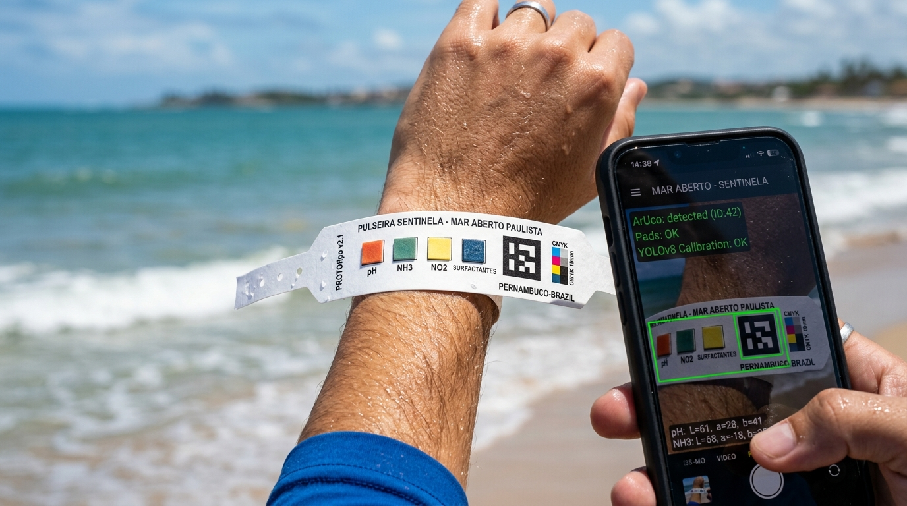
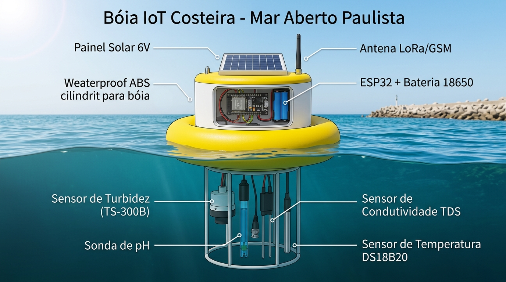

# brw · Cauã da Cunha Lira

> folha do artefato [brainwriting híbrido](../3-brainwriting-hibrido.md). siga o guia passo a passo
> e preencha cada seção aqui. as decisões são suas, e decidir é saber explicar.

## 1 · onde atacar

**crise** (marque 1 com `x`):

| | crise |
|:-:|:--|
| [ ] | perda do raciocínio crítico e alienação (*slop*) |
| [ ] | a verdade sob mira e colapso epistêmico (*fakes*) |
| [ ] | manipulação política e democracia (*bots*) |
| [ ] | crise ecológica da IA (água e energia) |
| [ ] | alimentação com veneno e ultraprocessados (vs. feiras agroecológicas) |
| [ ] | endividamento e dreno das *bets* |
| [ ] | moradia e especulação (casas vazias) |
| [ ] | concentração de plataformas e trabalho |
| [x] | outra: contaminação costeira por esgoto clandestino, colapso da balneabilidade e invisibilidade epidemiológica de doenças de veiculação hídrica nas praias de Paulista-PE (Janga, Pau Amarelo, Conceição e Maria Farinha). |

por que esta crise: Paulista ocupa a 85ª posição no Ranking do Saneamento (Trata Brasil 2026), com apenas 40,5% de coleta de esgoto (mais de 200 mil moradores sem rede) e trechos do Janga, Pau Amarelo e Maria Farinha recorrentemente impróprios na CPRH por excesso de *Enterococos*. O município registra mais de 100 internações hospitalares graves por ano (1.907 acumuladas no SIH/DATASUS) e 695 óbitos históricos (SIM/DATASUS) por Doenças Relacionadas ao Saneamento Inadequado (DRSAI), mas ninguém cruza os atendimentos diários de gastroenterite nas UPAs/USFs com o banho de mar, mantendo os poluidores impunes e os restaurantes da orla sucateados.

**tecnologias de IA** (marque 3 e chame de A, B, C):

| | tecnologia de IA |
|:-:|:--|
| [ ] | modelos locais / no aparelho (*SLMs*, 1B–7B) |
| [x] A | sistemas multiagente e agência (*tools*, MCP) |
| [x] B | visão computacional e OCR |
| [ ] | voz (fala ↔ texto) e interfaces sem tela |
| [x] C | grafos e RAG (redes de grafos, busca vetorial) |
| [ ] | modelos de difusão / geração visual |
| [ ] | outra: [preencha] |

**infraestruturas tradicionais** (marque 3 e chame de 1, 2, 3):

| | infraestrutura |
|:-:|:--|
| [ ] | plataformas de dois lados (*matching*, como Uber) |
| [x] 1 | geolocalização, GPS e mapas |
| [ ] | e-commerce, marketplaces e catálogos |
| [x] 2 | mensageria leve e bots (WhatsApp, SMS) |
| [ ] | redes sociais, feeds e comunidades |
| [ ] | pagamento instantâneo (Pix, moeda local) |
| [ ] | crowdsourcing e curadoria coletiva |
| [x] 3 | outra: rede de bóias IoT de baixo custo nas saídas de galerias e trechos críticos das praias (Janga, Pau Amarelo, Conceição e Maria Farinha) |

## 2 · clichês

| clichê | o que acerta | onde fica raso |
|:--|:--|:--|
| **app "banhista alerta"** (mapinha de praia própria/imprópria) | comunica o risco de forma simples e visual ao cidadão comum. | transfere a culpa para a vítima; quando a família já está na areia do Janga ou Pau Amarelo, tende a ignorar o aviso e entrar na água. |
| **chatbot de denúncia ecológica** via WhatsApp | reduz o atrito para moradores relatarem línguas negras e esgoto na areia. | vira gaveta digital: acumula relatos soltos sem comprovar nexo causal nem gerar prova técnica para forçar obras. |
| **dashboard de balneabilidade** para a prefeitura | centraliza indicadores em um único painel gerencial. | não ataca a causa-raiz; gestores tendem a engavetar dados negativos para não expor a omissão municipal nem afastar turistas. |
| **campanhas educativas com IA** (cartazes e posts) | informa frequentadores e quiosques sobre descarte correto de lixo e óleo. | trata despejo clandestino de esgoto e omissão de saneamento básico como se fossem mera falta de educação ambiental do banhista. |
| **drone fiscalizador** que filma manchas na orla | gera registro visual pontual de línguas negras na faixa de areia. | operação cara e episódica; não mede contaminação invisível diluída na água (amônia, coliformes) e ignora o movimento das marés. |

## 3 · matriz 3 × 3 e a minha ideia

cada célula: **nome** · frase de até 20 palavras (quem usa, o que faz).

| | 1 · geolocalização, GPS e mapas | 2 · mensageria leve e bots (WhatsApp) | 3 · bóias IoT nas praias |
|:--|:--|:--|:--|
| **A · sistemas multiagente e agência (*tools*, MCP)** | **1. ZonaViva** · Agentes cruzam tábua de marés e pontos de despejo para atualizar mapa de microzonas seguras para barraqueiros e banhistas. | **2. DossiêBot** · Moradores enviam relatos no WhatsApp; agentes buscam dados públicos da CPRH/USFs e montam representação técnica para o MPPE. | **3. VigiaOrla** · Bóias detectam descarga na praia; agentes acionam ferramentas de maré e clima para prever chegada da pluma aos banhistas. |
| **B · visão computacional e OCR** | **4. MapaÓptico** · Banhistas e barraqueiros fotografam reagentes na praia; visão calibra a cor sob o sol e plota contaminação no mapa. | **5. TriagemZap** · Profissionais das USFs fotografam boletins de virose no WhatsApp; OCR extrai praia do banho e horário sem redigitação. | **6. BoyaVision** · Bóias na costa de Paulista ativam câmera quando a turbidez sobe; visão diferencia mancha de esgoto de sedimento natural. |
| **C · grafos e RAG (redes de grafos)** | **7. GrafoMaré** · Rede de grafos modela correntes e trechos de 300m entre Janga e Maria Farinha para isolar manchas sem interditar tudo. | **8. SentinelaUSF** · Agentes de saúde e barraqueiros consultam no WhatsApp o grafo que liga surtos de gastroenterite nas UPAs às praias. | **9. NexoCosteiro** · Rede de grafos conecta séries das bóias IoT aos registros de virose nas USFs, provando a origem do surto. |

**as 9 no mapa impacto × viabilidade:**

| | viabilidade alta | viabilidade baixa |
|:--|:--|:--|
| **impacto alto** | **1. ZonaViva** — evita interditar a orla inteira de Paulista injustamente; agentes cruzando tábua de marés e pontos críticos cabem num protótipo no semestre. **4. MapaÓptico** — dá leitura rápida na areia para famílias e barraqueiros; calibrar cor de reagente por foto no celular é testável em bancada. **8. SentinelaUSF** — conecta doentes reais às praias de Janga, Pau Amarelo, Conceição e Maria Farinha pelo WhatsApp; simular o grafo com séries epidemiológicas cabe no semestre. | **3. VigiaOrla** — antecipa o deslocamento da mancha na praia; exige instalar e manter bóias físicas na costa. **6. BoyaVision** — separa esgoto de lama de chuva na água; exige hardware aquático com câmera e proteção contra maresia. **9. NexoCosteiro** — prova a relação entre descarga de esgoto na praia e surto clínico na USF; exige bóias ativas e fluxo contínuo de dados de saúde. |
| **impacto baixo** | **2. DossiêBot** — organiza denúncias para o MPPE, mas sozinho não impede o banho contaminado no fim de semana; bot com busca pública é direto de montar. **5. TriagemZap** — poupa digitação na USF, mas sozinho não mede a água do mar; OCR de fichas no WhatsApp é um teste delimitado. | **7. GrafoMaré** — modela correntes entre trechos de 300m, mas sem leitura real de contaminação na entrada vira apenas simulação teórica. |

onde discordei da IA, e por quê: a IA colocou o **9. NexoCosteiro** em viabilidade baixa por exigir bóias físicas nas praias e integração com as USFs. Eu mantive o NexoCosteiro porque acredito que a única forma de mover as autoridades é com as bóias ligadas aos casos nas USFs: precisamos de algo palpável para dar nome e rosto a quem está contaminando as praias de Janga, Pau Amarelo, Conceição e Maria Farinha. Para viabilizar no semestre sem perder esse peso probatório, uso componentes reais de baixo custo (~R$ 490 por bóia) e projetos de monitoramento aquático como referência, simulo a telemetria cruzada com a tábua de marés oficial e valido em bancada a leitura óptica de reagentes pelo celular.

**minha ideia escolhida:** **9. NexoCosteiro** · Rede de grafos conecta séries das bóias IoT aos registros de virose nas USFs, provando a origem do surto.

**por que ela, sem IA, em até 3 linhas:**
A bóia é indispensável para medir detalhes reais da água e o seu nível de contaminação na praia.
A visão entra para identificar exatamente onde a água da orla está mais crítica para quem vai entrar no mar.
E a USF é a cereja do bolo: a imprensa e as autoridades só se movem para mudar quando o caso é mostrado estourando dentro de uma USF.

## 4 · motores

| motor | nome | frase | o que mudou em relação à ideia |
|:--|:--|:--|:--|
| inverter | **Atestado da Areia** | Quando a UPA registra pico de gastroenterite, o grafo calcula a maré reversa para apontar de qual emissário saiu o esgoto 48h antes. | O fluxo se inverte: em vez de a bóia prever o surto na USF, o surto clínico rastreia de trás para frente o ponto emissor na praia. |
| canalizar | **Escudo do Barraqueiro** | Donos de barracas e restaurantes testam a água em frente ao ponto para provar que sua comida não causou virose, alimentando o grafo. | O interesse egoísta do comerciante em defender seu faturamento gera monitoramento diário da orla sem depender de fiscais do governo. |
| transplantar | **Microzona de 300m** | Como no controle de tráfego aéreo por setores, o grafo divide Janga, Pau Amarelo, Conceição e Maria Farinha em faixas de 300m. | Transplanta o isolamento por células de espaço aéreo para o mapa da praia, protegendo comerciantes de trechos limpos. |
| reescalar | **Pulseira Sentinela** | Além das bóias fixas, banhistas e barraqueiros usam pulseiras reagentes descartáveis de centavos lidas pela câmera do celular na areia. | Reescala o sensor químico 100× para baixo: da bóia fixa no mar para uma pulseira impermeável (~R$ 0,70) no pulso do banhista. |
| trocar a persona | **Escudo da Mãe** | Mães de crianças pequenas usam a pulseira e consultam o mapa no WhatsApp antes de liberar o banho no Janga ou Pau Amarelo. | Quem aciona o sistema na ponta deixa de ser apenas o técnico/USF e passa a ser a família na areia protegendo os filhos. |
| trocar o contexto | **Sentinela de Maria Farinha** | Adapta o grafo para monitorar o encontro do rio com o mar e áreas de lazer náutico em Maria Farinha e Conceição. | Expande o foco das praias urbanas de quebra-mar (Janga e Pau Amarelo) para zonas estuarinas e de turismo náutico (Maria Farinha). |
| trocar a tecnologia | **Triagem Vocal na UPA** | Um modelo local de voz transcreve relatos de pacientes na triagem da UPA para extrair em qual praia tomaram banho. | Sai a rede de grafos sobre sensores e entra um modelo de reconhecimento de fala (*fora da matriz*) capturando o vínculo praia-doença. |
| juntar | **Mar Aberto Paulista** | Junta `NexoCosteiro` (bóia + USF), `ZonaViva` (agentes de maré no mapa) e `MapaÓptico` (visão lendo pulseira) numa arquitetura única. | O grafo deixa de cruzar apenas bóia e USF: passa a fundir o sensor fixo, a leitura óptica da pulseira na areia e o mapa de 300m. |
| restringir | **Sinal Físico Sem Rede** | Se o 4G cair na praia lotada, a pulseira muda de cor visivelmente e a bóia aciona sinal luminoso na água quando satura. | Sob restrição de zero internet ou tela durante o banho, o alerta básico opera de forma química e visual imediata. |

## 5 · o que fica e o que sai

**o que eu gostei:** gostei da união completa no **Mar Aberto Paulista** (`juntar`), porque mantém o foco nas praias de Paulista (Janga, Pau Amarelo, Conceição e Maria Farinha) para proteger as famílias, reabrir restaurantes e salvar o faturamento dos barraqueiros (`canalizar`). Também gostei da rastreabilidade reversa (`inverter`) para dar nome e endereço aos pontos de despejo clandestino a partir dos surtos nas USFs e na UPA de Jardim Paulista.

**o que achei interessante:** substituir fitas soltas de papel (que rasgam, molham ou voam no vento da praia) por **pulseiras descartáveis reagentes** em Tyvek de ~R$ 0,70 (`reescalar`), calibradas em conjunto com as bóias físicas de baixo custo (~R$ 490). E o isolamento por **microzonas de 300m** (`transplantar`), que impede que um ponto historicamente reprovado pela CPRH (como na Rua Betânia ou Cláudio S. Bastos no Janga) condene injustamente trechos limpos de Pau Amarelo, Conceição ou Maria Farinha.

**o que eu descarto, e por quê:** descarto depender de *selfies* aleatórias de redes sociais ou de multas debitadas automaticamente do SUS sem perícia, porque são mecanismos frágeis e juridicamente inviáveis. Também deixo a transcrição por voz dentro do consultório da UPA (`trocar a tecnologia`) fora do escopo inicial para evitar barreiras de sigilo médico, preferindo consolidar notificações de diarreia aguda por faixa de praia via WhatsApp e boletins epidemiológicos (SIVEP-DDA/DATASUS).

**minha ideia completa:** **Mar Aberto Paulista · Nexo Costeiro e Escudo da Orla**

Banhistas e barraqueiros das praias do Janga, Pau Amarelo, Conceição e Maria Farinha usam pulseiras impermeáveis Tyvek com *pads* reagentes (~R$ 0,70/un., sensíveis a amônia, nitrito e pH) lidas pela câmera do celular, enquanto bóias IoT solares de baixo custo (~R$ 490/un., com ESP32 e sensores de turbidez ST100, pH PH4502C e condutividade TDS) monitoram pontos críticos da orla (incluindo os trechos vigiados pela CPRH na Rua Betânia, Cláudio S. Bastos, Forte de Pau Amarelo e Cabanga), somadas à triagem de Doenças Diarreicas Agudas nas USFs, Prontoclínica Torres Galvão e UPA de Jardim Paulista via WhatsApp.  
Na ponta, um modelo de **Visão Computacional** (YOLOv8-nano/MobileNet) localiza o marcador ArUco na pulseira e calibra a cor no espaço CIELAB descontando o reflexo do sol na areia; no servidor, **Agentes MCP** consultam a **Tábua de Marés da Marinha (DHN)**, correntes (**Open-Meteo Marine API**) e chuvas da **APAC**, alimentando uma **Rede Neural de Grafos Espaço-Temporal (ST-GNN)**.  
Regras determinísticas baseadas na **Resolução CONAMA nº 274/2000** validam os limites físico-químicos e delimitam **microzonas de 300m** no mapa da orla.  
O sistema preenche o "ponto cego" atual do DATASUS — onde Paulista acumula mais de 100 internações graves/ano e 695 óbitos por DRSAI sem saber quantos casos nas UPAs vieram do banho de mar —, gerando prova técnica georreferenciada para o MPPE e a CPRH responsabilizarem quem polui e blindando os restaurantes de trechos limpos.

## 6 · refinamento

**a · e se todo mundo usasse?** em 5 anos, as praias do Janga, Pau Amarelo, Conceição e Maria Farinha sairiam da invisibilidade epidemiológica: os dossiês técnicos ligando despejos clandestinos em tempo seco aos atendimentos nas UPAs/USFs forçariam obras de esgotamento (hoje estagnado em 40,5% em Paulista), reduzindo internações por DRSAI e reabrindo restaurantes na orla. A mãe usa a pulseira por instinto direto de proteção, para os filhos não terminarem o domingo tomando soro na UPA. O barraqueiro e o dono de restaurante usam como escudo comercial: compram o lote de pulseiras de centavos para provar que a água em frente à barraca estava própria e que eventual mal-estar não veio do seu peixe ou camarão, protegendo seu faturamento.

**b · a IA que não pode faltar.** técnica: Rede Neural Convolucional (CNN on-device para calibração colorimétrica CIELAB), Rede Neural em Grafo Espaço-Temporal (ST-GNN com *message passing*) e Agentes de IA com *Tool Use* / Protocolo de Contexto de Modelo (MCP) · aula da disciplina: Aula 07 · arquiteturas de deep learning (1/4) (`slides · redes convolucionais` e `slides · redes de grafos`) e Aula 13 · superinteligência e singularidade (`slides · agência`)

por que sem ela não roda: a luz solar intensa na areia altera a percepção da pulseira reagente a olho nu e em fotos comuns; a Visão Computacional localiza o marcador fiducial ArUco e corrige a iluminação no espaço CIELAB para extrair o índice químico real. Já a dispersão costeira entre Janga, Pau Amarelo, Conceição e Maria Farinha é não linear e tem defasagem clínica: os Agentes MCP coletam marés da Marinha e chuvas da APAC, e a ST-GNN modela como a pluma se desloca pelas faixas de 300m até gerar atendimentos por gastroenterite na UPA de Jardim Paulista e nas USFs de 24h a 72h depois. Cálculos de limites CONAMA e horários de maré usam regras fixas, mas regras estáticas ("choveu, interdita tudo") quebram comerciantes inocentes e não detectam despejo clandestino em dia de sol. Se um formulário estático ou regra simples atingisse a mesma precisão de rastreamento e leitura óptica em campo, eu retiraria a IA e voltaria aos motores.

**c · o cético e as saídas**

| crítica | saída 1 | saída 2 | minha decisão |
|:--|:--|:--|:--|
| **1. Viabilidade química da pulseira:** testes rápidos na praia podem sofrer interferência de salinidade e protetor solar, gerando falsos positivos se tentarem medir bactéria diretamente. | Triagem química indireta: reagir em segundos a amônia, nitrito, detergentes e pH em vez de cultura lenta de 24h para *Enterococos*/*E. coli*. | Calibração mútua: a pulseira opera como triagem rápida no raso com correção óptica, mas a bóia IoT com sensores calibrados garante o peso técnico do laudo. | **Escolho a Saída 2 combinada aos marcadores da Saída 1.** A pulseira não substitui a bóia: ela dá segurança imediata na areia, enquanto a bóia física sustenta o rigor pericial para o MPPE e a CPRH. |
| **2. Adoção e custo contínuo:** o poder público municipal pode atrasar ou recusar a compra recorrente das pulseiras descartáveis e a manutenção das bóias. | Comércio local financia as pulseiras: como cada pulseira Tyvek + tira reagente custa ~R$ 0,70 no atacado, restaurantes e barraqueiros compram lotes e entregam como selo de segurança na mesa. | Piloto enxuto apoiado em associação local e pesquisa universitária (~R$ 490 por bóia) nos pontos críticos monitorados pela CPRH no Janga e Pau Amarelo. | **Escolho a Saída 1 para as pulseiras e a Saída 2 para as bóias no piloto.** O interesse financeiro direto do barraqueiro em provar a qualidade do seu ponto paga a pulseira sem depender de prefeitura. |
| **3. Pânico e dano econômico injusto:** um alerta de contaminação pode esvaziar a cidade inteira e quebrar barraqueiros de praias que estavam limpas. | Microzoneamento de 300m: o grafo isola apenas a faixa atingida pela pluma e certifica os trechos vizinhos como seguros. | Aviso reservado de 24h para os comerciantes antes de publicar o mapa para os banhistas. | **Escolho a Saída 1 e rejeito a Saída 2.** Dar aviso prévio secreto criaria incentivo para esconder dados e burlar a fiscalização; o microzoneamento de 300m é transparente com as famílias e justo com o comerciante. |

## 7 · resumo, sem IA

Em Paulista-PE (85º lugar no Ranking Trata Brasil, com apenas 40,5% de coleta de esgoto), despejos clandestinos reprovam trechos de Janga, Pau Amarelo, Conceição e Maria Farinha na CPRH, enquanto o município acumula mais de 100 internações graves anuais e 695 óbitos no DATASUS por doenças ligadas ao saneamento (DRSAI) sem cruzar quantos atendimentos nas UPAs vêm do banho de mar.  
O **Mar Aberto Paulista** cria esse elo ausente: une bóias IoT de baixo custo (~R$ 490) nas praias, pulseiras reagentes (~R$ 0,70) lidas pela câmera do celular e registros de diarreia aguda das USFs e da UPA de Jardim Paulista via WhatsApp.  
Visão Computacional calibra a leitura da pulseira sob o sol, enquanto Agentes MCP (consultando marés da Marinha e chuvas da APAC) e uma Rede Neural de Grafos (ST-GNN) isolam microzonas de 300m e rastreiam o ponto poluidor.  
Se todo mundo usasse, laudos técnicos georreferenciados tirariam a contaminação costeira da invisibilidade estatística, forçando obras de saneamento e devolvendo os turistas aos restaurantes da orla.  
Cada mãe usa para proteger seus filhos de adoecerem no mar, e cada barraqueiro usa como escudo para provar que sua comida é limpa e proteger o faturamento da sua barraca.

---

## Anexo Técnico · Dados Oficiais, Protótipos Visuais e Orçamento Real (BOM)

### A · Quadro de Evidências Reais em Paulista-PE (Fontes Públicas Verificadas)

| Indicador / Dimensão | Dado Oficial Verificado | Fonte Pública |
|:--|:--|:--|
| **Posição Nacional em Saneamento** | **85ª posição** entre os 100 maiores municípios do Brasil (investimento per capita de R$ 51,55/hab., muito abaixo do patamar de universalização). | [Ranking do Saneamento Trata Brasil 2025/2026](https://tratabrasil.org.br/) (base SINISA/SNIS) |
| **Déficit de Coleta de Esgoto** | Apenas **40,26% a 40,54%** da população tem coleta de esgoto (**mais de 200 mil habitantes sem rede coletora**; 8.000 domicílios sob risco de inundação). | [Infosanbas / UFMG – Paulista-PE](https://infosanbas.org.br/municipio/paulista-pe/) e [Instituto Água e Saneamento (IAS)](https://www.aguaesaneamento.org.br/municipios-e-saneamento/pe/paulista) |
| **Pontos Críticos nas Praias de Paulista** | Reprovações frequentes por *Enterococos* (>100 NMP/100mL, CONAMA 274/00): **Janga** (Rua Cláudio S. Bastos nº 190 e Rua Betânia), **Pau Amarelo** (Forte) e **Maria Farinha** (Cabanga). | [Boletim Semanal de Balneabilidade – CPRH/PE](https://www2.cprh.pe.gov.br/) |
| **Internações Graves e Óbitos por DRSAI** | **1.907 internações hospitalares graves** na série histórica em Paulista (**104 a 174 internações/ano** recentes; pico de 312/ano) e **695 óbitos acumulados** (**32 a 46 mortes/ano**). Em PE: **8.179 internações/ano** (80% feco-orais/diarreias). | **SIH/DATASUS** e **SIM/DATASUS** consolidados no [Infosanbas – Saúde e Saneamento em Paulista](https://infosanbas.org.br/municipio/paulista-pe/#Sa%C3%BAde-e-saneamento) |
| **A Lacuna de Dados (Onde o Projeto Atua)** | Casos ambulatoriais de gastroenterite/diarreia aguda atendidos na **UPA de Jardim Paulista**, **Prontoclínica Torres Galvão** e **USFs da orla** que tomam soro sem internar não são vinculados à praia de exposição no DATASUS. | Monitoramento **SIVEP-DDA / SES-PE** |

### B · Protótipos Visuais dos Dispositivos

| Pulseira Reagente (`Pulseira Sentinela`) | Bóia Costeira de Baixo Custo (`Bóia IoT Paulista`) |
|:--:|:--:|
|  |  |
| *Pulseira Tyvek impermeável com 4 pads colorimétricos (pH, Amônia, Nitrito e Surfactantes) e marcador fiducial ArUco para calibração solar via Visão Computacional.* | *Bóia solar com ESP32 + LoRa/GSM no topo estanque e sondas submersas de Turbidez (ST100), pH (PH4502C), Condutividade (TDS) e Temperatura (DS18B20).* |

### C · Orçamento Real de Componentes e Links de Compra no Brasil

#### 1. Bóia IoT Costeira Completa (Custo de Protótipo: ~R$ 408,00 a R$ 578,00 por unidade)

| Componente | Especificação / Papel no Grafo | Preço Médio (R$) | Links de Compra no Brasil |
|:--|:--|:--|:--|
| **Sensor de Turbidez Óptica** | Modelo **ST100 / TS-300B** (mede opacidade e sólidos em suspensão em NTU na saída de galerias). | R$ 55,00 – R$ 75,00 | [Usinainfo (ST100)](https://www.usinainfo.com.br/outros-sensores-arduino/sensor-de-turbidez-arduino-para-monitoramento-da-agua-st100-4539.html) · [Mercado Livre](https://lista.mercadolivre.com.br/sensor-turbidez-arduino-ts-300b) |
| **Kit Sensor de pH + Sonda BNC** | Módulo **PH4502C** com eletrodo BNC (detecta variação ácido-base de despejos domésticos/químicos). | R$ 135,00 – R$ 190,00 | [Mercado Livre (Kit PH4502C)](https://lista.mercadolivre.com.br/sensor-ph-4502c-bnc) · [Blog Técnico Usinainfo](https://www.usinainfo.com.br/blog/sensor-de-turbidez-projeto-de-leitura-da-qualidade-da-agua/) |
| **Medidor de Condutividade / TDS** | Módulo **TDS Meter V1.0** com sonda à prova d'água (mede sólidos dissolvidos em ppm; identifica carga orgânica). | R$ 70,00 – R$ 95,00 | [Projeto e Loja Usinainfo](https://www.usinainfo.com.br/blog/projeto-medidor-de-tds-arduino-para-condutividade-da-agua/) · [Mercado Livre](https://lista.mercadolivre.com.br/sensor-tds-condutividade-arduino) |
| **Sonda de Temperatura Submersível** | Sensor digital **DS18B20** em cápsula de aço inox (compensação térmica das leituras de pH e TDS). | R$ 18,00 – R$ 28,00 | [Mercado Livre (DS18B20 Inox)](https://lista.mercadolivre.com.br/sensor-temperatura-ds18b20-prova-dagua) |
| **Microcontrolador + Energia Solar** | Placa **ESP32 (LoRa/GSM)** + Mini Painel Solar 6V + Bateria Li-Ion 18650 + Carcaça estanque ABS/PVC. | R$ 130,00 – R$ 190,00 | [Mercado Livre (ESP32 + Painel Solar)](https://lista.mercadolivre.com.br/esp32-lora-painel-solar) |

#### 2. Pulseira Reagente Descartável (Custo Unitário: ~R$ 0,62 a R$ 1,10 por pulseira)

| Insumo | Especificação / Papel na Triagem Óptica | Preço do Pacote (R$) | Custo Unitário | Links de Compra no Brasil |
|:--|:--|:--|:--|:--|
| **Pulseira Sintética Impermeável Tyvek** | Pacote com 1.000 pulseiras invioláveis (impressas com marcador **ArUco** e escala de branco para Visão Computacional). | R$ 65,00 – R$ 120,00 (milheiro) | **R$ 0,07 – R$ 0,12** | [Mercado Livre (Milheiro Tyvek)](https://lista.mercadolivre.com.br/pulseira-tyvek-1000-unidades) |
| **Tiras Reagentes Colorimétricas para Água** | Frasco com 100 tiras multi-parâmetros (**Amônia, Nitrito, Nitrato, pH**) segmentadas e aderidas à pulseira. | R$ 55,00 – R$ 98,00 (100 tiras) | **R$ 0,55 – R$ 0,98** | [Mercado Livre (Tiras Reagentes Água)](https://lista.mercadolivre.com.br/tiras-reagentes-agua-ph-nitrito-amonia) |
